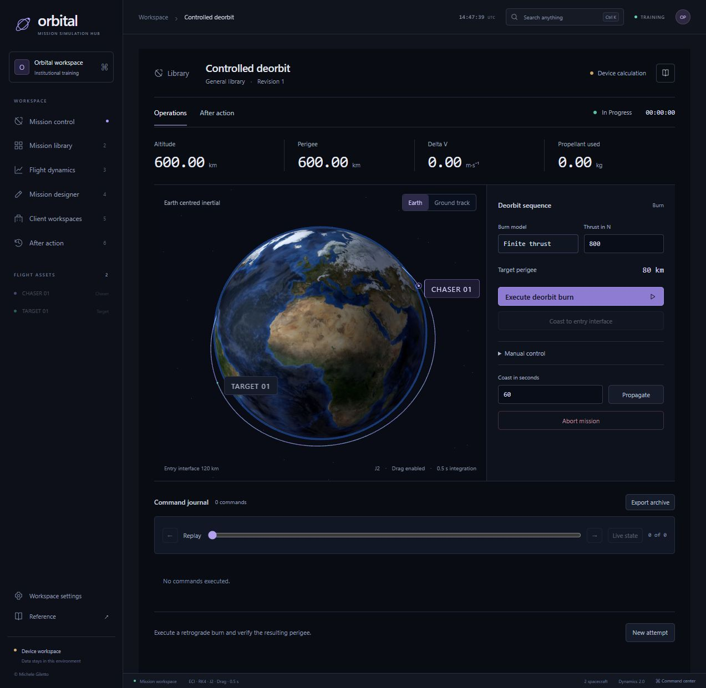

Orbital Mission Simulation Hub

[Project and screenshots](https://giletto-systems-lab.michele-giletto.chatgpt.site/projects/orbital), [browser evaluation](https://giletto-systems-lab.michele-giletto.chatgpt.site/orbital/), [technical report](https://giletto-systems-lab.michele-giletto.chatgpt.site/orbital/Orbital-technical-report.pdf) and [offline application](https://giletto-systems-lab.michele-giletto.chatgpt.site/orbital/Orbital.zip).



[Download the offline application](distribution/Orbital.zip), [read the technical report](publication/Orbital-technical-report.pdf) and [download the publication materials](publication/Orbital-publication.zip).

Version 0.3.0 is an engineering evaluation release for technical training with synthetic spacecraft. Orbital combines a dark English workspace, a mission library, customer scenario authoring, numerical execution and assessment from the recorded commands.

Docking, passive recovery and deorbiting use the shared nonlinear inertial dynamics engine. Proximity exercises measure the relative state of two propagated vehicles, apply bounded guidance thrust, consume propellant and check ordered hold points before explicit capture. Recovery includes bounded scalar roll tracking. Deorbiting supports impulsive and finite burns and records the descending 120 km interface. The scenario editor configures vehicle properties, initial relative state, approach limits, maneuver budget and assessment thresholds for each client revision.

Mission control also supports multiple spacecraft, scheduled maneuvers, J2 gravity, an engineering drag approximation, numerical forecasts, ground tracks and seeded trajectory dispersion. The library contains twelve base exercises across transfer, docking, recovery, disposal, inspection and separation. Results preserve the scenario used for the run. Replay reconstructs the command sequence and assessment reports the measured objective checks. A family name alone does not identify model fidelity; the retained educational linear exercises are documented separately from advanced runs.

Original source and documentation remain proprietary to Michele Giletto. [EVALUATION.md](EVALUATION.md) grants 30 days of internal nonoperational evaluation, including local execution and creation of scenario variants, without registration or external activation. Redistribution, paid instruction, production deployment and commercial reuse require separate permission. Third party components retain their own licenses. Read [LICENSE](LICENSE) before distribution or deployment.

Use Node 22.13 or later. Run these commands from the product directory.

```powershell
npm ci --ignore-scripts
npm run dev
```

Start the API in a second terminal.

```powershell
npm run api
```

The web listens at http://127.0.0.1:4317 and the API at http://127.0.0.1:4318. Local development uses a loopback identity. With the local API, advanced mission commands are server authoritative and persisted with signed receipts. Device local evaluation remains available when the API is absent; the interface identifies its storage mode. Production federation, TLS, key custody and network policy require the configuration described in the administrator and security documents.

```powershell
npm run verify
npm run sbom
npm audit --audit-level=moderate
npm run package
```

Verification runs the test suite, strict TypeScript checking and production compilation. Packaging writes an offline application, a source archive and signed release metadata to the workspace outputs directory. The general package contains the synthetic base catalog. Client deliveries contain only the selected collection. In an extracted delivery, run `node verify.mjs`, establish trust in the public key separately, then start `node launch.mjs`. Private signing keys, identity configuration, working sessions and client data are excluded from public artifacts.

For a compiled local service, run `npm run build`, start the API with `npm start`, then run `node apps/web/serve.mjs` in another terminal. The compiled web server applies CSP and other security headers. Development uses Vite and does not apply the compiled server policy.

The monorepo contains `apps/web`, `apps/api`, `packages/sim-core`, `packages/contracts`, `packages/security`, `packages/delivery`, `tests`, `scripts`, `docs` and `infra`. React and Three.js render the application. Node serves the API. The strict TypeScript kernel is shared between browser and server to keep model and command behavior aligned. Local Earth imagery and other bundled assets allow graphical evaluation without an external imagery service.

Read [advanced mission behavior](docs/advanced-missions.md), [flight dynamics](docs/flight-dynamics.md), [library authoring](docs/library.md), [instructional design](docs/instructional-design.md), [user procedures](docs/user-manual.md), [administration](docs/admin-manual.md), [security](docs/security.md), [API definitions](docs/openapi.yaml), [verification](docs/verification.md) and the [roadmap](docs/roadmap.md). The [publication directory](publication/README.md) contains the technical report, measured synthetic cases, commercial assessment, evaluation protocol and prepared LinkedIn copy.

Model limits are part of the evaluation. The advanced engine uses fourth order Runge Kutta, central gravity, optional J2 and static engineering drag. Attitude is scalar rather than full rigid body dynamics. Capture is a logical event and excludes contact mechanics. Disposal propagation ends at the descending 120 km interface and excludes heating, fragmentation and ground impact. The Earth view uses documented photographic composites rather than a live Earth feed. No operational flight qualification, independent physical validation, measured learning benefit, government accreditation, verified smart card integration or FIPS validated key custody is claimed. Deployment definitions require recipient environment validation; physical headsets and containers have not been verified on this workstation.

A useful first customer evaluation is one bounded training exercise with the customer's own acceptance criteria. Compare scenario preparation effort, repeatability and the usefulness of the final review against the existing process. Dedicated libraries, scenario adaptation and deployment integration are possible paid scopes. Customer demand and economic benefit must be established through that evaluation.

© 2026 Michele Giletto. All rights reserved.
